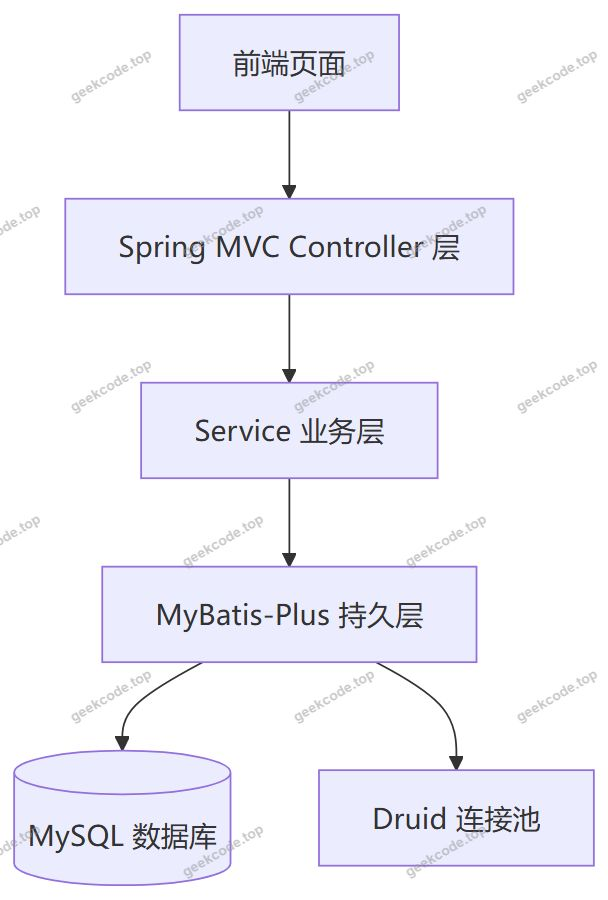
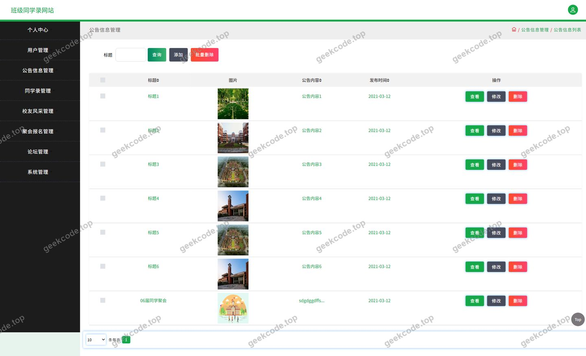
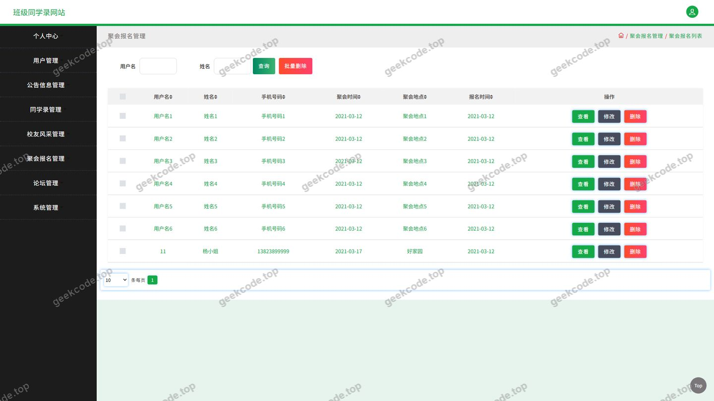
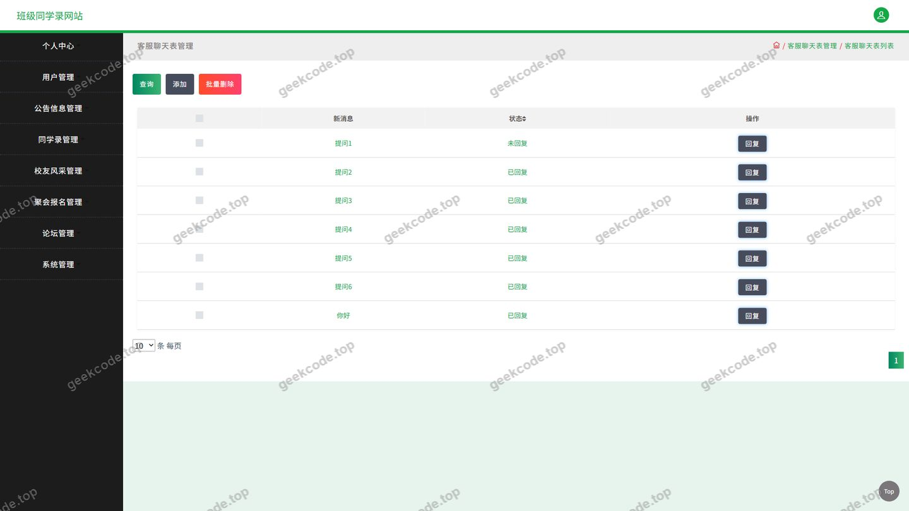
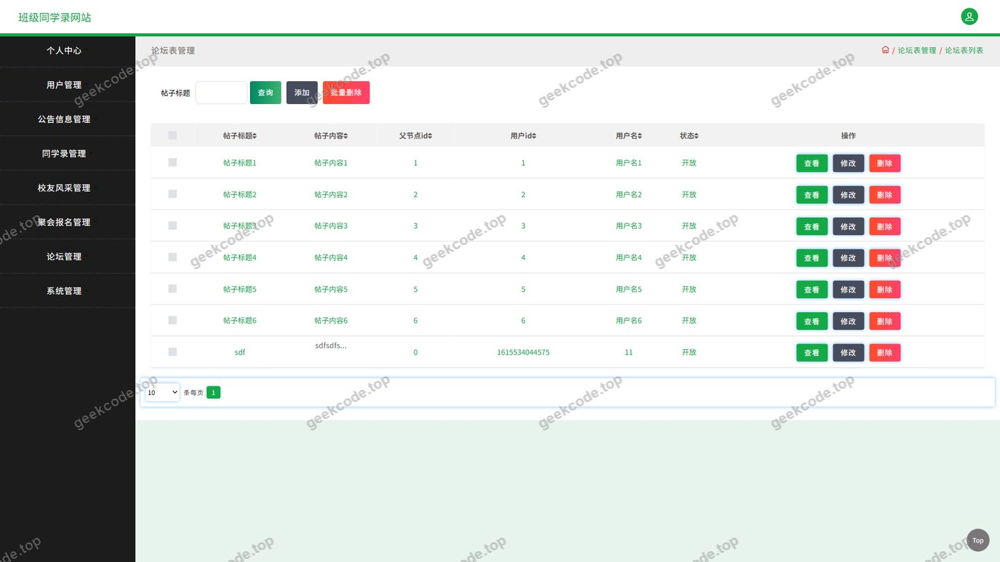
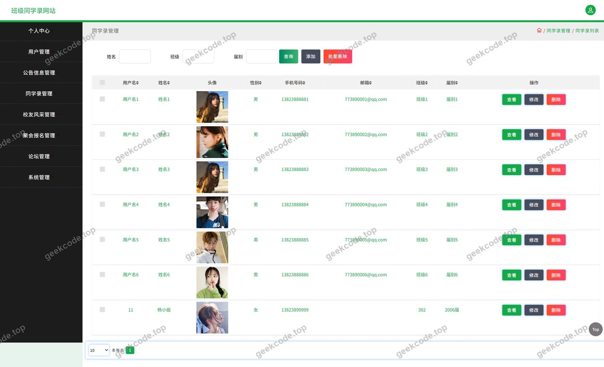
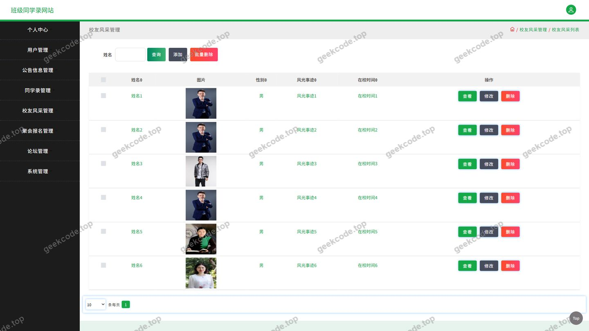
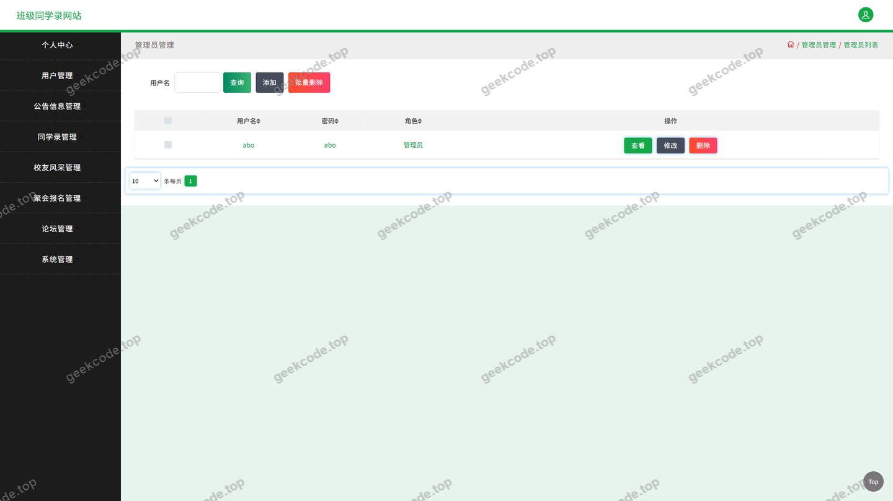
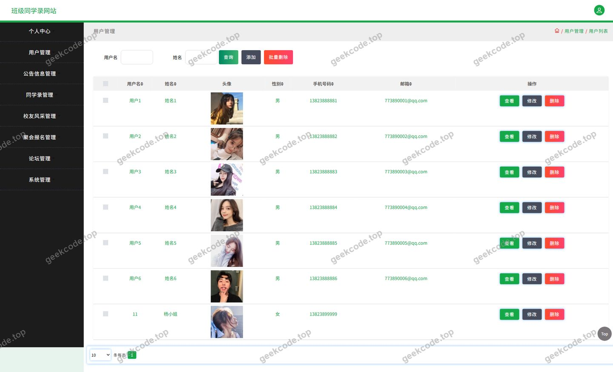

# ssm班级同学录网站-java毕业设计

> 🎓 **计算机毕业设计 · ssm班级同学录网站-java毕业设计**
>
> 本仓库只放**项目介绍 + 运行截图**（截图是站点带水印的原图，存在仓库 `images/` 里）。
>
> 👉 **完整可运行源码 / 数据库脚本 / 部署文档：[点我获取](https://geekcode.top/archives/ssm%E7%8F%AD%E7%BA%A7%E5%90%8C%E5%AD%A6%E5%BD%95%E7%BD%91%E7%AB%99-java%E6%AF%95%E4%B8%9A%E8%AE%BE%E8%AE%A1?utm_source=github)**
>
> 💬 咨询微信：**ir9372**　|　🌐 更多项目：[极客代码 geekcode.top](https://geekcode.top/?utm_source=github)
>
> 📌 项目详情页：<https://geekcode.top/archives/ssm%E7%8F%AD%E7%BA%A7%E5%90%8C%E5%AD%A6%E5%BD%95%E7%BD%91%E7%AB%99-java%E6%AF%95%E4%B8%9A%E8%AE%BE%E8%AE%A1?utm_source=github>

<table><td width="230" align="center"> <b>扫码加微信 ir9372</b></td><td valign="middle">📦 源码 = 项目介绍 + 全部运行截图 + 数据库 + 部署文档 👉 点上方任意截图，直接跳到 <b>极客代码 geekcode.top</b> 详情页</td></table>

---

<h1>ssm班级同学录网站-java毕业设计</h1>
<h2>项目概述</h2>

班级同学录网站是一套面向班级同学与校友群体的信息交流与联络平台，采用 Java 技术栈开发，属于典型的 SSM 架构毕业设计项目。系统以“同学录”为核心，围绕校友信息维护、班级动态发布与同学互动展开，提供公告信息、校友风采、论坛信息、聚会报名、同学录、客服聊天等主要功能模块，并配套个人中心与“我的发布”入口，方便用户管理个人信息与发布内容。

项目采用前后端分离的接口式设计思路，后端基于 Spring + Spring MVC + MyBatis-Plus 构建，持久层使用 MyBatis-Plus 简化单表操作，数据库连接由 Druid 连接池统一管理，接口以 RESTful 风格对外提供数据服务。系统面向已毕业或在校的班级同学、校友以及平台管理员，用于沉淀班级通讯信息、发布班级公告、展示校友风采、组织聚会报名并支持在线交流，适用于班级、院系、同学会等中小型组织的校友联络场景。

<h2>技术架构</h2>

系统整体采用分层架构，自上而下划分为表现层、控制层、业务层与持久层，各层职责清晰、低耦合。

<strong>后端架构</strong>

<ul>
<li>表现层：由 Spring MVC 承担，通过 <code>@Controller</code> / <code>@RequestMapping</code> 等注解暴露接口，各业务控制器按领域划分，包括 <code>UserController</code>、<code>YonghuController</code>、<code>GonggaoxinxiController</code>、<code>XiaoyoufengcaiController</code>、<code>ForumController</code>、<code>JuhuibaomingController</code>、<code>TongxueluController</code>、<code>ChatController</code>、<code>ConfigController</code>、<code>FileController</code>、<code>CommonController</code>。</li>
<li>业务层：负责业务规则处理与事务控制，依托 Spring 的 <code>spring-tx</code>、<code>spring-context-support</code> 进行声明式事务与容器管理。</li>
<li>持久层：采用 MyBatis-Plus 作为 ORM 框架，基于其通用 Mapper 与条件构造器减少样板代码，覆盖同学录、公告、论坛、报名等实体的增删改查。</li>
<li>切面与容器：通过 <code>spring-aop</code>、<code>spring-beans</code>、<code>spring-core</code> 提供依赖注入与横切能力。</li>
</ul>

<strong>数据库设计要点</strong>

数据库围绕核心业务实体进行建模，主要包括：用户/校友信息、公告信息、校友风采、论坛信息、聚会报名、同学录、聊天消息、系统配置与文件资源等表。表间通过用户标识与业务标识建立关联，例如同学录与用户关联、论坛与发布者关联、聚会报名与活动及用户关联，保证数据的完整性与可追溯性。具体字段与约束以实际建表脚本为准。

<strong>核心技术选型理由</strong>

<ul>
<li>Spring + Spring MVC：成熟的 IoC/AOP 容器与 Web 框架，便于分层解耦与事务管理。</li>
<li>MyBatis-Plus：在 MyBatis 基础上提供通用 CRUD 与条件构造能力，提升开发效率，适合毕业设计规模的数据访问需求。</li>
<li>Druid：功能完善的数据库连接池，具备连接监控与 SQL 统计能力，便于运行期排查性能问题。</li>
<li>JUnit：用于对业务逻辑进行单元测试，保证代码质量。</li>
</ul>
<h2>功能模块</h2>

根据系统控制器与页面划分，功能按用户端与管理端组织如下。

<strong>用户端功能</strong>

<ul>
<li>登录：用户身份认证入口，用于进入系统并访问各功能模块。</li>
<li>公告信息：浏览班级发布的公告内容，对应 <code>GonggaoxinxiController</code>。</li>
<li>校友风采：查看校友展示信息，对应 <code>XiaoyoufengcaiController</code>。</li>
<li>论坛信息：参与论坛帖子浏览与互动，对应 <code>ForumController</code>。</li>
<li>聚会报名：查看聚会活动并提交报名，对应 <code>JuhuibaomingController</code>。</li>
<li>同学录：维护与查看班级同学通讯信息，对应 <code>TongxueluController</code>。</li>
<li>客服聊天：在线客服或即时交流功能，对应 <code>ChatController</code>。</li>
<li>个人中心：查看与维护个人资料，提供个人中心入口。</li>
<li>我的发布：集中管理本人发布的内容，提供我的发布入口。</li>
</ul>

<strong>管理端功能</strong>

<ul>
<li>用户管理：对平台用户信息进行维护，对应 <code>UserController</code>、<code>YonghuController</code>。</li>
<li>公告管理：发布与维护公告信息。</li>
<li>校友风采管理：维护校友风采展示内容。</li>
<li>论坛管理：管理论坛帖子与互动内容。</li>
<li>聚会报名管理：查看与管理聚会报名记录。</li>
<li>同学录管理：维护同学录数据。</li>
<li>系统配置：维护系统相关配置项，对应 <code>ConfigController</code>。</li>
<li>文件管理：处理文件上传与资源访问，对应 <code>FileController</code>、<code>CommonController</code>。</li>
</ul>
<h2>用户角色与权限</h2>

系统角色划分为普通用户（校友/同学）与管理员两类。

<strong>普通用户（校友/同学）</strong>

<ul>
<li>登录：完成身份认证后进入系统。</li>
<li>公告信息：浏览公告列表与详情。</li>
<li>校友风采：浏览校友风采内容。</li>
<li>论坛信息：浏览论坛帖子，参与发布与互动，并通过“我的发布”管理本人内容。</li>
<li>聚会报名：查看聚会活动并提交报名信息。</li>
<li>同学录：查看与维护本人相关的同学录信息。</li>
<li>客服聊天：使用在线客服聊天功能。</li>
<li>个人中心：查看与修改个人资料、账号相关信息。</li>
</ul>

<strong>管理员</strong>

<ul>
<li>用户管理：对用户/校友账号信息进行维护。</li>
<li>公告信息管理：发布、修改与维护公告内容。</li>
<li>校友风采管理：维护校友风采展示数据。</li>
<li>论坛信息管理：管理论坛帖子及互动内容。</li>
<li>聚会报名管理：查看与管理聚会报名记录。</li>
<li>同学录管理：维护同学录数据。</li>
<li>系统配置管理：维护系统配置项。</li>
<li>文件管理：管理上传文件与相关资源。</li>
</ul>
<h2>项目特色与创新点</h2>
<ul>
<li>以“同学录”为核心定位：区别于通用社交平台，系统聚焦班级同学与校友联络场景，将公告、风采、论坛、聚会报名、同学录等功能整合于一体，形成闭环的班级信息管理方案。</li>
<li>采用 MyBatis-Plus 简化持久层：通过通用 Mapper 与条件构造器降低重复 CRUD 代码量，使业务逻辑更聚焦于核心流程。</li>
<li>引入 Druid 连接池：在保证数据库连接稳定性的同时，提供运行期监控能力，便于开发与运维阶段观察 SQL 执行情况。</li>
<li>分层清晰、易于扩展：控制器按业务领域拆分，接口职责明确，便于后续按模块迭代与维护。</li>
<li>面向毕业设计场景：技术栈主流、结构规范，覆盖用户管理、内容发布、在线互动、数据统计等常见设计要素，适合作为教学与答辩演示项目。</li>
</ul>
<h2>部署环境</h2>

运行本项目需要以下软件环境：

<ul>
<li>JDK：用于编译与运行 Java 后端程序，需与项目所使用的 Spring 版本兼容。</li>
<li>Maven：用于依赖管理与项目构建，加载 <code>spring-core</code>、<code>spring-webmvc</code>、<code>spring-jdbc</code>、<code>spring-tx</code>、<code>spring-aop</code>、<code>spring-beans</code>、<code>spring-context</code>、<code>spring-context-support</code>、<code>mybatis-plus</code>、<code>druid</code>、<code>junit</code> 等依赖。</li>
<li>MySQL：作为关系型数据库，存储用户、公告、论坛、报名、同学录等业务数据。</li>
<li>Servlet 容器（如 Tomcat）：由于项目基于传统 Spring MVC 而非内嵌容器，需部署至外部 Servlet 容器运行。</li>
<li>Druid：作为数据库连接池组件，随应用启动完成连接管理。</li>
<li>浏览器：用于访问系统页面与各功能模块。</li>
</ul>

根据现有信息，项目未提及 Node.js 或微信开发者工具等前端构建与小程序运行环境。

<h2>五、技术特性</h2>
<ul>
<li>使用 MyBatis-Plus 简化数据访问层开发</li>
</ul>
<h2>六、功能模块截图</h2>
<h3>后台管理端</h3>
<h4>页面-登录</h4>

<h4>页面-公告信息</h4>

<h4>页面-聚会报名</h4>

<h4>页面-客服聊天</h4>

<h4>页面-论坛</h4>

<h4>页面-同学录</h4>

<h4>页面-校友风采</h4>

<h4>页面-用户</h4>

<h4>页面-用户</h4>

---

## 获取完整源码

| 项目 | 说明 |
| --- | --- |
| 项目名 | ssm班级同学录网站-java毕业设计 |
| 运行截图 | 本文 10 张（站点带水印原图，仓库 `images/` 目录） |
| 完整源码 | [https://geekcode.top/archives/ssm%E7%8F%AD%E7%BA%A7%E5%90%8C%E5%AD%A6%E5%BD%95%E7%BD%91%E7%AB%99-java%E6%AF%95%E4%B8%9A%E8%AE%BE%E8%AE%A1?utm_source=github](https://geekcode.top/archives/ssm%E7%8F%AD%E7%BA%A7%E5%90%8C%E5%AD%A6%E5%BD%95%E7%BD%91%E7%AB%99-java%E6%AF%95%E4%B8%9A%E8%AE%BE%E8%AE%A1?utm_source=github) |
| 咨询微信 | **ir9372**（备注：jingpin-yuanma） |
| 更多项目 | [极客代码 geekcode.top](https://geekcode.top/?utm_source=github) |

> 需要源码、部署、改配置、跑不起来等问题，加微信 ir9372 沟通，说明项目名即可。
